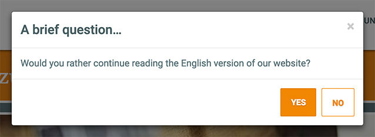

After the package is installed, some html is included at the start or the end of
the html body section. The position and the content of this html code can be changed via a system setting.

The rendered output can look like this:

## How it works

LangSuggest needs [Babel](https://modx.com/extras/package/babel) and uses the
contexts listed in the `babel.contextKeys` system setting. Each of these contexts
needs a `cultureKey` context setting. Additional language codes for a context can
be set with a comma separated `cultureKeyAliases` context setting.

On each rendered page, the plugin compares the browser accepted languages (the
`Accept-Language` header, sorted by q factor) with the culture keys of the Babel
contexts:

1. An exact match wins, i.e. `pt-BR` matches a context with the culture key `pt-br`.
2. Otherwise the base language matches, i.e. `pt-BR` matches a context with the
   culture key `pt-pt`. If several contexts share that base language, the one
   that the browser requests explicitly is preferred, then the plain base
   language, then the first one.
3. If no browser language matches, the context in the `babel.contextDefault`
   system setting is used.

If the detected context is not the current context, the LangSuggest chunk is
added to the page and the body tag gets the `langsuggestActive` class, that can
be used for styling.

LangSuggest is not shown, if the visitor has the LangSuggest cookie (it is set
when the language is switched with the button in the chunk) or if the display
count of the session is used up. In session-less contexts, LangSuggest is only
shown, if the **Session-less Contexts** system setting is enabled. The display
count is not used in that case.

The culture keys of the Babel contexts are cached. Clear the MODX cache, after
the contexts or their culture keys were changed.

### Reset

Add `langsuggest_reset=1` to the URL of a page to remove the LangSuggest cookie
and reset the display count of the current session. This is useful for testing.

## Chunks and placeholder

Two sample chunks are available that can be duplicated, renamed, and referenced in the system settings: `tplLangSuggestBar` and `tplLangSuggestModal`.

`tplLangSuggestModal` will display a modal window (a native HTML `dialog` element with Bootstrap 3 class names), that suggests to redirect to the translation of the current resource in the preferred language of the visitor.  
`tplLangSuggestBar` will display a Bootstrap 3 styled bar with a language select box, that is filled by the `BabelLinks` snippet and uses the `tplLangSuggestBarOption` chunk for the options.

Both sample chunks use plain JavaScript and don't require jQuery or the Bootstrap JavaScript. The modal chunk contains some basic styles and uses the Bootstrap 3 button styles, if they are available. When the visitor switches the language with the button in the chunk, a cookie is set, that hides LangSuggest for the configured cookie expiration. A cookie expiration of `0` creates a session cookie. Closing the chunk (with the close button, the no button, the Esc key or a click on the modal backdrop) does not set the cookie. In that case, LangSuggest is shown again on the next page, until the display count of the session is used up.

The following placeholders are available in the chunk:

| Key               | Description                                                                                                       |
|-------------------|-------------------------------------------------------------------------------------------------------------------|
| cookie_expiration | The expiration of the cookie in days. The cookie is set, when the visitor switches the language with the button.  |
| cookie_name       | The name of the cookie, that hides LangSuggest. The cookie is set, when the language is switched with the button. |
| cultureKey        | The culture key of the context with the preferred browser accepted language.                                      |
| current_id        | The id of the current resource.                                                                                   |
| debug             | The value of the debug system setting.                                                                            |
| redirect_id       | The id of the Babel translation of the current resource in the preferred context or the site start of that context. |

## System Settings

LangSuggest uses the following system settings in the namespace `langsuggest`:

| Key                           | Name                  | Description                                                                                                                                                         | Default             |
|-------------------------------|-----------------------|---------------------------------------------------------------------------------------------------------------------------------------------------------------------|---------------------|
| langsuggest.chunk_position    | Chunk Position        | The position of the LangSuggest chunk output in the body section of the rendered page. Can be set to `top` or `bottom`.                                            | bottom              |
| langsuggest.cookie_expiration | Cookie Expiration     | The number of days LangSuggest stays hidden after the language was switched with its button. `0` creates a session cookie.                                          | 365                 |
| langsuggest.cookie_name       | Cookie Name           | The name of the cookie that is set by LangSuggest, when the language should be switched. Characters other than letters, digits, `_` and `-` are replaced with `_`. | LangSuggest         |
| langsuggest.debug             | Debug                 | Log debug information in the MODX error log.                                                                                                                        | No                  |
| langsuggest.display_count     | Display Count         | Maximum display count of LangSuggest modal for each session, if a PHP session exists.                                                                               | 3                   |
| langsuggest.no_session        | Session-less Contexts | Show LangSuggest on session-less contexts.                                                                                                                          | No                  |
| langsuggest.tpl               | Modal Template        | The template chunk containing the LangSuggest modal.                                                                                                                | tplLangSuggestModal |
